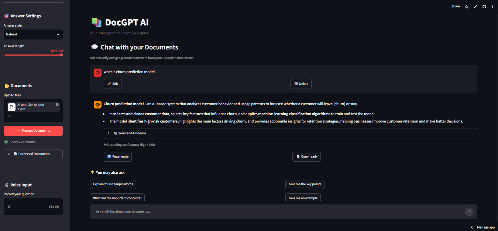

# 📚 DocGPT AI — Evidence-First Document Intelligence

**Live Demo:** [https://docgpt--rag-ai.streamlit.app/](https://docgpt--rag-ai.streamlit.app/)

## 🚀 About the Project
DocGPT AI is an intelligent document assistant that lets you chat with your PDFs, PPTX, DOCX, and CSV files. It uses a hybrid retrieval pipeline (FAISS + BM25) with Cross-Encoder reranking to provide grounded answers with exact citations.



## ✨ Features
- 💬 **Chat with Documents:** Ask questions and get grounded answers with confidence scores.
- 🔍 **Document Comparison:** Compare information across two different files.
- 📖 **Study Mode:** Generate MCQs, flashcards, viva questions, and revision notes.
- 🎯 **Quiz Mode:** Test your knowledge with interactive quizzes based on your documents.
- 🎙️ **Voice Input:** Ask questions using your voice (Whisper via Groq).

## 🛠️ Tech Stack
- **Frontend:** Streamlit
- **Backend:** Python
- **Embeddings:** Hugging Face (`all-MiniLM-L6-v2`)
- **Vector Database:** FAISS
- **Keyword Search:** BM25 + Reciprocal Rank Fusion (RRF)
- **Reranker:** Cross-Encoder (`ms-marco-MiniLM-L-6-v2`)
- **LLM:** Groq API (`openai/gpt-oss-120b`)

## ⚙️ How to Run Locally
1. Clone the repository:
   ```bash
   git clone https://github.com/lovely-1512/DOCGPT_AI_PROJECT.git

2. Install dependencies:
   '''
   pip install -r requirements.txt
   
3. Set your Groq API key:
   '''
   export GROQ_API_KEY= "your_api_key_here"
   
4. Run the app:
   '''
   streamlit run app.py   
